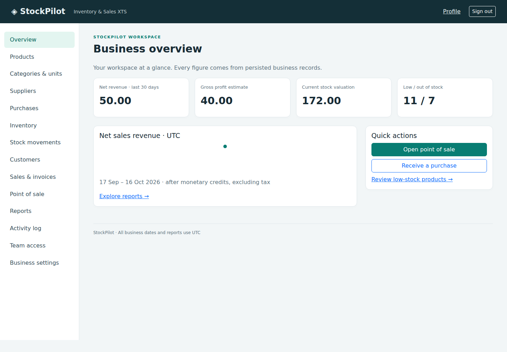

<!-- BEGIN animated project showcase -->
<picture>
  <source media="(prefers-reduced-motion: reduce) and (max-width: 600px)" srcset=".github/showcase/still-emerald-overview-mobile.svg">
  <source media="(prefers-reduced-motion: reduce)" srcset=".github/showcase/still-emerald-overview.svg">
  <source media="(max-width: 600px)" srcset=".github/showcase/emerald-overview-mobile.svg">
  
</picture>
<!-- END animated project showcase -->

# StockPilot — Inventory & Sales Management

A single-business inventory and sales application built with **ASP.NET Core 10 MVC + REST API**, **EF Core SQL Server**, **Identity**, **Bootstrap 5**, Razor and Fetch. The MVC application and API share the same authorization, pricing, stock and settlement services.

## Working features

- Identity sign-in/sign-out, profile, persistent account lockout, IP throttling and protected team administration.
- Admin, Manager, SalesStaff and InventoryStaff roles with server and invoice-ownership checks.
- Categories, units, catalog, unique SKUs, barcode search, archived products, low-stock thresholds and paginated directories.
- Supplier/customer management, archival and linked purchase/sales history; walk-in sales require no customer record.
- Multi-line purchase drafts and atomic full receiving, discount-adjusted moving-average cost and historical purchase lines.
- Fetch-powered POS/cart, server-validated selling prices, stock-safe confirmation, historical invoices and print layouts.
- Cash/card/bank/mobile payment records, derived balances, partial monetary refunds and one-time full physical sale returns.
- Audited adjustments, immutable stock movements, persisted dashboard and date-range financial reports.
- Admin business name and ledger currency setup. Currency freezes after the first document.

Inventory mutations are serialized with a database-scoped, transaction-owned SQL Server application lock. Product rowversion, constraints and persisted idempotency keys add defenses. See [concurrency design](docs/INVENTORY_CONCURRENCY.md) and [business rules](docs/BUSINESS_RULES.md).

## Projects

| Project | Responsibility |
|---|---|
| `StockPilot.Core` | Entities, DTOs, roles, financial rules |
| `StockPilot.Infrastructure` | EF/Identity, SQL migrations, shared application services |
| `StockPilot.Api` | `/api/v1` controllers, compiled as a library into the Web host |
| `StockPilot.Web` | MVC, Razor, local assets, authentication pipeline |
| `StockPilot.UnitTests` | Isolated financial/permission invariants |
| `StockPilot.IntegrationTests` | Relational workflows, HTTP, SQL concurrency and opt-in Chromium |

There is one deployable host; a second API process is intentionally unnecessary. [Architecture](docs/ARCHITECTURE.md) · [Schema](docs/DATABASE_SCHEMA.md) · [API](docs/API_DOCUMENTATION.md) · [Permissions](docs/PERMISSIONS.md)

## Prerequisites and setup

For an existing portable SDK, set `DOTNET_ROOT` to its directory and prepend that directory to `PATH` **in the current process only** before running the commands below. Do not alter user/system PATH.

Requires .NET SDK **10.0.402** (pinned in `global.json`), ASP.NET Core runtime 10 and **SQL Server 2022 or newer**. Use an existing SQL installation or obtain approval before installing one. Do not apply migrations to an existing production database without review and backups. No automatic migration/reset runs on application startup.

```powershell
dotnet restore StockPilot.sln --locked-mode
dotnet build StockPilot.sln -c Release --no-restore
dotnet tool restore
```

Create a **new empty development database** through an authorized SQL operator. Give the migration principal the needed DDL rights only for that database; use a separate runtime principal with only required table read/write and application-lock execution rights. Do not grant runtime server-admin permissions. SQL Server supports the application lock under the default public database principal.

Set connection configuration privately. This example uses Windows authentication and a placeholder server/database; replace them with your authorized local instance. `TrustServerCertificate=true` is for a trusted local development server only.

```powershell
$env:ConnectionStrings__StockPilot = 'Server=YOUR_LOCAL_SQL_INSTANCE;Database=YOUR_NEW_STOCKPILOT_DEV_DATABASE;Integrated Security=true;Encrypt=true;TrustServerCertificate=true'
dotnet ef database update --project src/StockPilot.Infrastructure --startup-project src/StockPilot.Web
```

For SQL authentication, provide secrets through your environment or ASP.NET User Secrets, never source files. The EF design factory reads `ConnectionStrings__StockPilot`; explicitly set it for migration commands even when runtime uses User Secrets.

Initialize the administrator once using securely supplied `Bootstrap__Email` and `Bootstrap__Password` (12+ characters, upper/lower/digit/symbol). Do not put a real password in shell history. For example obtain a credential in a local secure prompt, map it to process variables, and clear the password immediately after the bootstrap command. Bootstrap refuses if an administrator already exists; it never resets an existing account or grants public admin access.

```powershell
$bootstrap = Get-Credential -Message 'Choose the initial StockPilot administrator email and password'
$env:Bootstrap__Email = $bootstrap.UserName
$env:Bootstrap__Password = $bootstrap.GetNetworkCredential().Password
try { dotnet run --project src/StockPilot.Web -- --bootstrap-admin }
finally {
    Remove-Item Env:Bootstrap__Password -ErrorAction SilentlyContinue
    Remove-Item Env:Bootstrap__Email -ErrorAction SilentlyContinue
    $bootstrap = $null
}
$env:ASPNETCORE_ENVIRONMENT = 'Development'
dotnet run --project src/StockPilot.Web -- --urls http://localhost:5080
```

Open `http://localhost:5080`, sign in, choose **Business settings** and configure your ledger currency, then add categories/units/products and suppliers. Create a purchase, review the draft and receive it before making stock-dependent sales. All amounts use one configured two-decimal ledger currency; no conversion occurs.

Development OpenAPI: `/openapi/v1.json`. Static assets are vendored locally; no CDN or external API is required at runtime. Production uses HTTPS-only auth cookies and HSTS: [deployment/security checklist](docs/SECURITY.md).

## Screenshots

Actual Chromium captures from CI run [38875954372](https://github.com/rifatur17/StockPilot-Inventory-Sales-Management/actions/runs/38875954372) at `f213059`, using persisted isolated test fixtures and the XTS test currency. These are application screenshots, not mockups or production business data.



[Desktop invoice](docs/screenshots/invoice-desktop.png) · [Mobile invoice](docs/screenshots/invoice-mobile.png)

## Verification

```powershell
dotnet test StockPilot.sln -c Release
node --check src/StockPilot.Web/wwwroot/assets/app.js
node --check src/StockPilot.Web/wwwroot/assets/cart.js
dotnet list StockPilot.sln package --vulnerable --include-transitive
```

Local default integration tests create a unique temporary SQLite `_test.db`; SQL-only and browser facts are explicitly skipped unless enabled. This does **not** establish SQL locking correctness. CI creates a unique empty `_test` database inside a disposable SQL Server container, applies both project migrations and executes SQL concurrency/HTTP tests. The browser job additionally exercises actual Chromium UI workflows. See [testing instructions](docs/TESTING.md) for exact flags and scope.

[CI](https://github.com/rifatur17/StockPilot-Inventory-Sales-Management/actions/workflows/ci.yml) · [Security](https://github.com/rifatur17/StockPilot-Inventory-Sales-Management/actions/workflows/security.yml). Test results are evidence only for the commit on which they ran; consult workflow logs and the [verification record](docs/VERIFICATION.md).

## Scope and limitations

Full receiving and full physical sale returns are supported. Partial receiving, partial physical returns, supplier returns/purchase reversals, multiple warehouses, real payment gateways, image uploads, accounting exports and self-service password reset/email delivery are not implemented. Monetary partial refunds are supported independently of physical stock returns. Catalog reactivation happens automatically and is audited when a full sale return restores an archived product.

Gross profit is an estimate excluding operating expenses, inventory adjustment losses and nonrecoverable-tax accounting. Reports are current-state completion-date cohorts, not historical as-of accounting statements. Reports limit date ranges to 366 days and 10000 documents; user administration displays up to 200 accounts. App-lock serialization suits a small single-business workload; distributed throughput/load and external-DB-writer behavior need separate evaluation.

No production deployment or local SQL Server installation is included. Existing original repository history and authors are preserved; new commits use the authorized solo-developer identity.
