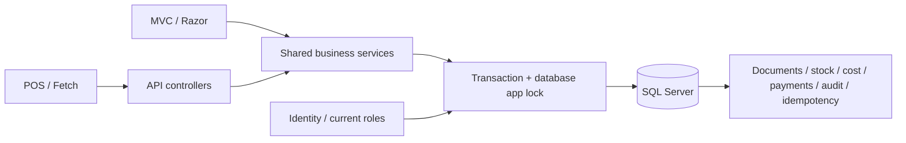

# Architecture

.NET 10 supported projects separate domain/contracts, infrastructure, API routing and MVC. `StockPilot.Web` is the single process and imports API controllers from `StockPilot.Api`. Controllers use `BusinessService` and `UserService`; neither UI nor JavaScript writes inventory directly. EF entities are mapped to response DTOs. Queries use `AsNoTracking`, database filtering/order/pagination, bounded report cohorts and batch relation loads rather than per-item queries.

`BusinessService` is split by catalog, documents, stock, sales, settings and reporting responsibilities. `LedgerGate` is the transaction boundary. It obtains the database-wide application lock before loading active accounts/roles or mutable business rows. Every app mutation follows that convention, including permission changes. See the concurrency document for the retry contract. There is intentionally no generic repository layer over EF.

Identity provides salted password hashing, database account lockout, security stamps and roles. Cookie authentication serves both MVC and Fetch API, with independent route attributes plus fresh service permission checks. Unsafe MVC/API methods require antiforgery; API authentication failures return ProblemDetails. Development-only OpenAPI is served by the Web host. No permissive CORS or trusted-forwarded-header middleware is enabled.

Static Bootstrap CSS and project JavaScript are local assets. Razor encodes user-controlled strings; cart results are built with `textContent`, not raw HTML. Print rendering shares the persisted invoice DTO. There are no hardcoded dashboard statistics, mocked production endpoints or JavaScript-owned totals.

Normal startup requires explicit SQL configuration and does not apply migrations or seed privileged users. Role/Admin bootstrap is an explicit one-shot operator command. Settings must establish the business currency before transaction creation. Unit and integration projects are separately runnable. SQLite exists only in Testing; the production provider is SQL Server.

